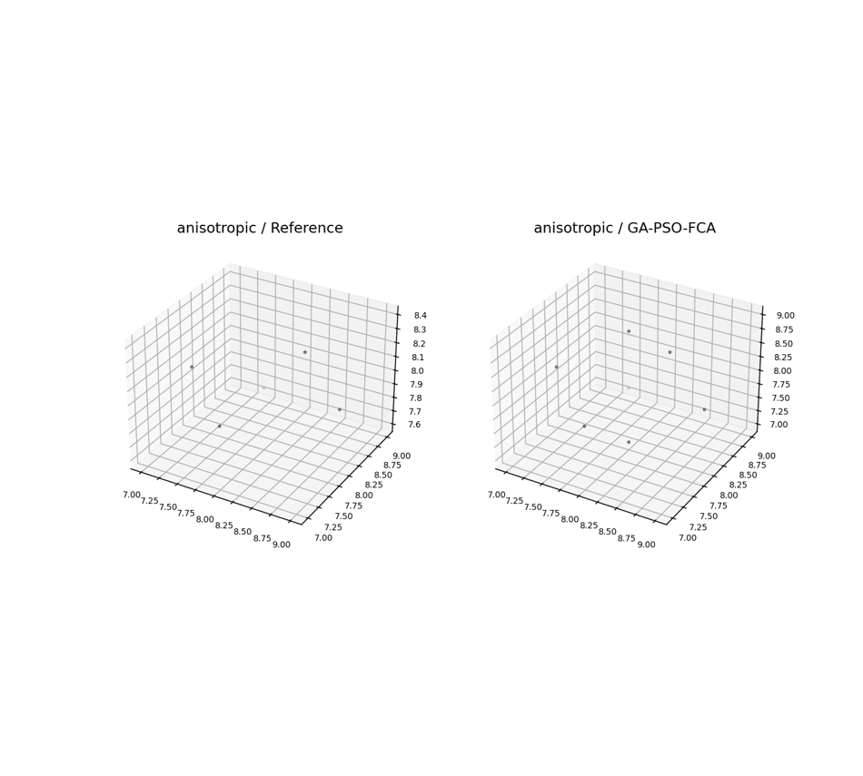

# GA-PSO-3D-FCA

**Auditable Python reproduction of** *基于GA–PSO分层优化的三维模糊元胞自动机扩散模型研究* (*Three-dimensional fuzzy cellular automata diffusion model based on GA–PSO hierarchical optimization*).

The reference PDF describes a conservative 3-D fuzzy cellular automaton (FCA) for a point-source diffusion field. A genetic algorithm (GA) searches **18 discrete structures** (6/18/26 neighborhoods × 3 fuzzy response modes × inverse-distance powers 1/2); a particle swarm (PSO) independently calibrates six continuous parameters for each chosen structure. This repository implements the forward model, GA, PSO, hierarchical GA→PSO, baselines, paper protocol, metrics, plots, and conservation tests.

> **Reproducibility status:** This is an **independent implementation**, not the original authors' source code. Several numerical definitions necessary to match exact reported values are missing in the paper. We explicitly document our choices instead of presenting calculated outputs as exact numerical replication. The `paper` mode reproduces the stated **experiment design**, but the paper's published metrics cannot be guaranteed.


## Manuscript-revision research branch: conservative-flux prototype

**New first-stage study (not part of the original authors' method):** `src/gapso_fca/conservative.py` provides a symmetric six-face, finite-volume-like fuzzy diffusion step with harmonic-mean material-interface conductance, impermeable masks, and adaptive CFL substeps. It reduces exactly to the ordinary Fickian CA for `strength=0` when no subcycling is required. The original `core.py` remains unchanged as a baseline.

A falsifiable test of the manuscript-style normalized outgoing fractions shows a near-equilibrium defect: for a uniform 9³ field with one cell lowered by `1e-10`, the paper-style implementation changes the state by `0.08584704` in one step; the new face-flux prototype changes it by `1.5554e-12`. This is a defect in the **stated normalization mechanism**, not evidence that the new approach is scientifically novel or universally more accurate.

Re-run the diagnostic experiment:

```bash
python -m gapso_fca.research --n 25 --steps 20 --out results/conservative_flux
pytest -q
```

The executed 25³, 20-step test (single protocol) produced the following RMSE against a normalized analytical point-source field, all from the solver rather than copied from the article:

| Case | CA | Original implemented FCA | Conservative neutral | Conservative fuzzy |
|---|---:|---:|---:|---:|
| Isotropic | 0.000425232 | 0.000300862 | 0.000425232 | 0.000232809 |
| Anisotropic | 0.000431756 | 0.000305191 | 0.000431756 | 0.000225502 |

These are **preliminary diagnostics, not full grid convergence or independent external validation**. The conservative neutral and CA columns match by construction; no speed or superiority claims over established numerical schemes are made.

- [Numerical derivation, limitations and verification plan](docs/numerical_defect_and_flux.md)
- [Generated CSV/JSON results](results/conservative_flux/summary.json)
- New tests: `tests/test_conservative.py`; the combined suite currently contains 22 passing tests.


## Quick start

```bash
python -m venv .venv
# Linux/macOS: source .venv/bin/activate
# Windows: .venv\\Scripts\\activate
pip install -e '.[test]'
pytest -q
# Fast verification (10³ optimization, 16³ validation, one seed):
ga-pso-fca --mode smoke --out results/runs/smoke
# Optional: 20 independent small-grid runs, with raw data but no images:
ga-pso-fca --mode smoke --seeds 20 --no-figures --out results/runs/smoke20
# Paper grid resolution, but reduced search budget for a quicker numerical check:
ga-pso-fca --mode verification --out results/runs/verification
# Article's 30³→50³ protocol with 30×30 GA, 30×30 PSO and 20 independent runs:
ga-pso-fca --mode paper --out results/runs/paper
```

**Warning:** `paper` mode is computationally demanding: every GA candidate triggers a complete PSO search, and every particle evaluation runs a multi-step 3D simulation. Expect substantial runtime; use `smoke` first. Default outputs under `results/runs/` are excluded from Git to prevent committing multi-run bulk data.

## Paper protocol versus implemented quantities

| Setting | Value |
|---|---|
| Domain | unit cube, center-cell point source, normalized mass M0=1 |
| Boundary | zero flux / no transfer outside the domain |
| Reference | 3D constant-coefficient Gaussian Green's function, discretized at cell centers and renormalized |
| Cases | isotropic D=(0.0016, 0.0016, 0.0016); anisotropic D=(0.0022, 0.0015, 0.0009) |
| Time | Δt=0.02, 50 total steps |
| Calibration | 30³ grid, time steps 10,20,30 |
| Held-out evaluation | 50³ grid, time steps 40,50 |
| Sensitivity | 30³, 40³ and 50³ grid sizes |
| GA | population 30, 30 generations, crossover .8, mutation .05 |
| PSO | 30 particles, 30 iterations, inertia .7, c1=c2=1.5 |
| Repetition | 20 independent random seeds |
| Params | Dx,Dy,Dz∈[.0006,.0028], λs∈[.70,1.15], mf∈[.35,.65], wf∈[.30,.80] |

Five variants: `CA` (explicit conservative Fickian 6-neighbor baseline), `FCA` (fixed structure/params), `GA-FCA` (structure search with fixed params), `PSO-FCA` (parameter calibration with fixed structure), `GA-PSO-FCA` (inner PSO reinitialized per GA structure). GA caches evaluated structures **within each independent run**; the cache contains results, not shared fitted parameters across distinct structures.

## Numerical details that the reference PDF does **not** fully specify

The source provides general fuzzy mapping Φ and a triangular membership formula, but **not the explicit consequents or complete numerical rule table**, the local input normalization, the formula mapping λs/D/Δt/grid length to λ0, the weights/scales used in the composite fitness, baseline initial parameter assignments, or the exact GA tournament/elitism details. The manuscript also alternates between **nine triangular membership endpoints** and **two optimized membership parameters** (mf,wf), without a unique reconstruction. A bitwise or metric-exact reproduction is therefore underdetermined from the supplied PDF alone.

**Declared defaults (implemented in `src/gapso_fca/core.py`):**

- Normalized gradient: positive neighbor difference divided by the current field peak, clipped to [0,1]. The three triangular fuzzy sets have centers (0,mf,1) and width wf as described in code.
- Rule consequents used for weighted-average defuzzification: neutral `(0.9,1.0,1.1)`, high-gradient-enhancing `(0.6,1.0,1.6)`, and high-gradient-suppressing `(1.4,1.0,0.6)`.
- Direction weight: `(Dx ox² + Dy oy² + Dz oz²) / distance² × distance^-p`.
- Stable total outgoing fraction: `lambda0=clip(2 dt lambda_s (Dx+Dy+Dz) / h², 0, .95)`. Actual destination fractions use the **paper's per-source P/sum(P)** normalization, and update all inflows and outflows simultaneously.
- Dimensionless objective: `mean(relative MSE)+0.1×absolute mass imbalance+0.02×relative spatial roughness`. These weights are **implementation choices**, not extracted from the article.
- Basic CA: conservative, explicit six-face Fickian exchange using the condition's stated diffusion coefficients, unlike the FCA's fraction-normalized directed flows. This ensures a meaningful physically grounded baseline, but is not guaranteed to be the paper's CA code.

These choices may materially change the resulting accuracy and rank ordering. **Do not present the experimental plots as reproduced copies of the paper's Figures 2–8.** They are fresh graphs of our run. The reference's tabulated validation RMSE/R² are shown below only as **targets to compare against**, not our experimental data.

| Article (table/section 3.3) | CA RMSE | FCA RMSE | GA-FCA RMSE | PSO-FCA RMSE | GA-PSO-FCA RMSE |
|---|---:|---:|---:|---:|---:|
| Isotropic | 2.373e-5 | 4.186e-5 | 3.267e-5 | 3.955e-5 | 3.055e-5 |
| Anisotropic | 2.823e-5 | 5.068e-5 | 4.043e-5 | 4.895e-5 | 3.786e-5 |

The original article states that ordinary CA outperforms all four fuzzy models on these simple constant-coefficient fields. An implementation claiming the hierarchical method always dominates ordinary CA would **misstate the source**.

## Actually executed smoke experiment

The example results below were **computed by this code**, with the *reduced* 10³→16³ protocol (not the official 30³→50³ study), seed=0, and very small GA/PSO budgets. The values are illustrative **integration-test measurements only**, not scientific comparators to the source's numbers.

| Condition | Model | Validation RMSE | R² |
|---|---|---:|---:|
| Isotropic | CA | 0.00285187 | 0.95107 |
| Isotropic | FCA | 0.00261637 | 0.95878 |
| Isotropic | GA-FCA | 0.00262060 | 0.95872 |
| Isotropic | PSO-FCA | 0.000840064 | 0.99518 |
| Isotropic | GA-PSO-FCA | 0.00114754 | 0.99121 |
| Anisotropic | CA | 0.00245869 | 0.96269 |
| Anisotropic | FCA | 0.00262410 | 0.95749 |
| Anisotropic | GA-FCA | 0.00266597 | 0.95598 |
| Anisotropic | PSO-FCA | 0.00112979 | 0.99204 |
| Anisotropic | GA-PSO-FCA | 0.00133189 | 0.98906 |

Run `ga-pso-fca --mode smoke` to regenerate the precise CSV, JSON, and all PNG images from scratch. Figures from the executed demo (actual model output):

**Isotropic diffusion: slices and model comparison**


**Anisotropic diffusion: 3D state and convergence**




## More executed evidence: repeated runs and article-resolution sanity checks

The implementation was additionally run with **20 independent seeds per condition** on the small 10³→16³ smoke protocol, with all five methods. There are **200 raw records** in [`results/smoke20_individual.csv`](results/smoke20_individual.csv), with aggregates in [`results/smoke20_summary.json`](results/smoke20_summary.json) and all structure counts in [`results/smoke20_selections.json`](results/smoke20_selections.json). The small-budget algorithm's values, averaged over 20 seeds, were:

| Case / model | FCA | GA-FCA | PSO-FCA | GA-PSO-FCA |
|---|---:|---:|---:|---:|
| Isotropic mean RMSE | 0.0026164 | 0.0026168 | 0.0019148 | **0.0011051** |
| Anisotropic mean RMSE | 0.0026241 | 0.0026605 | 0.0020825 | **0.0014609** |

The smoke runs did **not** reproduce the paper's near-unanimous 6-neighbor/R1 selection, which is unsurprising given the undocumented rules and substantially reduced budgets.

Separately, the 30³ optimization / 50³ validation **grid-resolution checks** (only one seed and small GA/PSO budgets, *not* the full paper run) produced GA-PSO-FCA RMSE **8.26152e-5** (isotropic) and **9.04013e-5** (anisotropic), markedly different from the article's **3.055e-5** and **3.786e-5**. See [`results/verification_summary.json`](results/verification_summary.json). This is documented as a non-reproduction of its published quantitative results, not concealed as agreement.

The release workflow in `.github/workflows/release.yml` builds a wheel and source distribution and attaches them to a GitHub Release **when a `v*` tag is pushed**. No release is claimed until the tag and GitHub Action have actually run.

## Repository layout

```text
src/gapso_fca/core.py         Conservative CA/FCA updates, Gaussian reference, fitness, metrics
src/gapso_fca/optimize.py     GA discrete search, independent PSO calibration, caching
src/gapso_fca/experiment.py   CLI, data collection, grid sensitivity, figures, CSV/JSON
experiments/paper_protocol.json Machine-readable article parameter settings
tests/test_core.py           Numerical consistency and reproducibility tests
assets/                      Figures from executed smoke run
results/smoke_summary.json    Single-seed smoke summary
results/smoke20_*.{json,csv}   20-seed small-grid experiment results
results/verification_summary.json   One-seed 30³→50³ sanity checks
```

The main outputs include `individual_results.csv`, `summary.json`, `run_config.json`, `grid_sensitivity.csv`, grid-sensitivity PNG, selections JSON, and isotropic/anisotropic slices, 3D states, metrics and convergence PNGs. All plotted measurements originate from the solver; the paper's expected metrics are never injected into evaluation or plotted as measured data.

## Tests and provenance

`pytest -q` currently passes **13 tests**, including conservation and non-negativity in all 6/18/26 neighborhood structures and all 3 rule modes, CA symmetry, anisotropic Gaussian behavior, identity metrics, and deterministic optimization. Code and plots are independently created for this reproduction; the supplied PDF is not redistributed in the repository.

**Future work for exact replication:** obtain the original authors' rule tables, λ0 mapping, raw scripts, random seeds, fitted parameters, and all fitness term scales. Re-run paper mode and compare the archived numerical outputs against Figures 2–8 and Tables 3–5 with differences disclosed.


### Additional numerical evidence: smooth Neumann-mode convergence

The independent [convergence benchmark](src/gapso_fca/convergence.py) tests the exact smooth Neumann eigenmode of the linear diffusion equation. Its 12³→32³ mesh refinement indicates a **2.02 observed order** for both the neutral conservative solver and the new **quadratic-gradient response** (`response_power=2`), while the earlier linear-gradient fuzzy response does not show second-order behavior over these grids. These are single-problem numerical observations, not a formal convergence theorem or evidence of novelty. See [CSV](results/conservative_flux/smooth_neumann.csv) and the [technical note](docs/numerical_defect_and_flux.md).

```bash
python -m gapso_fca.convergence --out results/conservative_flux
```
